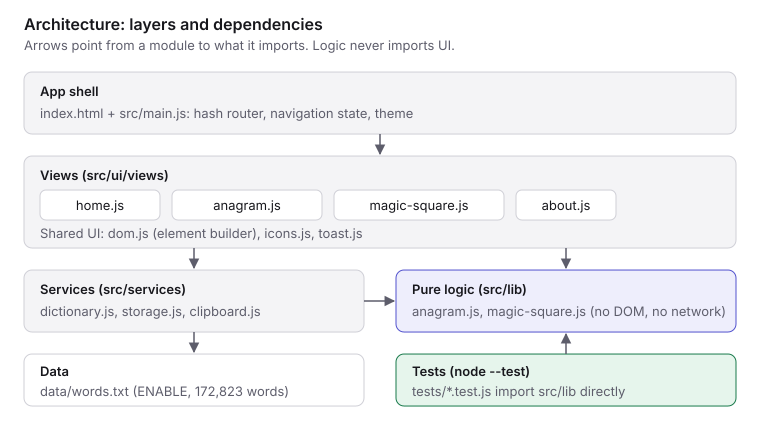
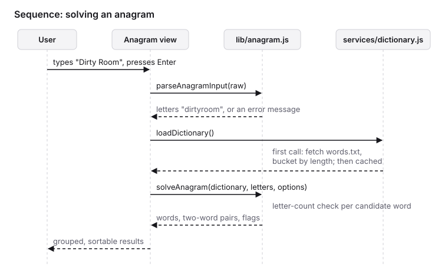
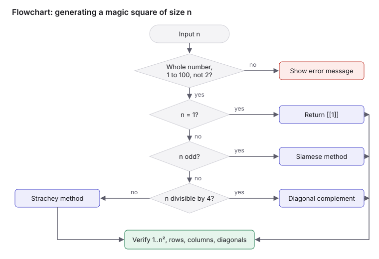

# Anagram Magic

Two small tools in one web app:

- **Anagram Solver** finds the real English words hidden in a word or phrase: full anagrams, shorter words and two-word anagrams.
- **Magic Square Generator** builds a verified magic square of any size from 1 to 100 (except 2, for which none exists).

It is a static site with no runtime dependencies and no build step. Everything runs in the browser.

## Run it

Requires Node.js 18 or later (only for the local server and the tests).

```bash
npm start
```

Then open http://localhost:5173. Set `PORT` to use another port.

The app uses ES modules and `fetch`, so it must be served over HTTP. Opening `index.html` from the file system will not work. Any static host works (GitHub Pages, Netlify, `python3 -m http.server`).

## Test

```bash
npm test
```

Tests use Node's built-in test runner, so there is nothing to install.

## Project structure

```
index.html              App shell: header, navigation, footer
assets/styles.css       Design tokens and all styles (light and dark themes)
data/words.txt          Word list, one word per line
src/main.js             Hash router, navigation state, theme toggle
src/lib/                Pure logic, no DOM (unit tested)
  anagram.js            Input parsing, word search, two-word anagrams, sorting
  magic-square.js       Generation, verification, export formats
src/services/           Browser-facing helpers
  dictionary.js         Lazy, cached word list loader
  storage.js            Safe localStorage wrappers, recent inputs
  clipboard.js          Copy and file download
src/ui/                 DOM helpers, icons, toast, and one module per page
tests/                  node:test suites for src/lib
scripts/serve.mjs       Dependency-free static dev server
docs/                   Diagrams
```



## How it works

### Anagram solver

Input is reduced to the letters a–z (case, spaces, digits and punctuation are ignored; accents are folded). The dictionary is bucketed by word length. A search visits only the buckets inside the requested length range and keeps each word whose letter counts fit inside the input's letter counts, so repeated letters are handled exactly. Words that use every letter are full anagrams.

Two-word anagrams: every word that fits the input is indexed by its sorted letters. For each candidate, the leftover letters are looked up in that index. Each pair is reported once.

A 30-letter input with two-word search finishes in well under a second.



### Magic squares

| Size | Method |
| --- | --- |
| 1 | The single cell `[1]` |
| 2 | Impossible; rejected with an explanation |
| Odd | Siamese (de la Loubère) method |
| Divisible by 4 | Diagonal complement method |
| Even, not divisible by 4 | Strachey method |

All methods run in O(n²). Every generated square is passed through `verifyMagicSquare`, which checks that 1..n² each appear once and that all rows, columns and both diagonals equal n(n² + 1) / 2.



## Word list and licence

`data/words.txt` is ENABLE (Enhanced North American Benchmark Lexicon), 172,823 words, by Alan Beale and M. Cooper, released into the public domain.

Limitations: English only, North American spellings, no proper nouns, no abbreviations, no one-letter words ("a", "I"), and it contains rare words accepted in word games.

The application code is under the licence in `LICENSE`.

## Limits

- Anagram input: 2 to 30 letters.
- Two-word anagrams: the first 500 pairs are shown.
- Magic squares: sizes 1 to 100. The cap keeps the grid usable; the algorithms have no such limit.
- One square is generated per size.
