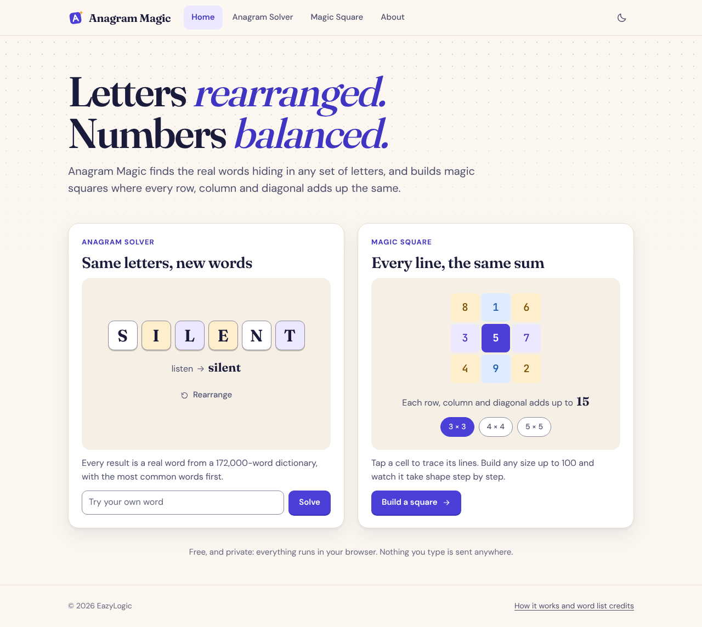

# Anagram Magic

Two small tools in one web app:

- **Anagram Solver** finds the real English words hidden in a word or phrase: full anagrams, shorter words and two-word anagrams.
- **Magic Square Generator** builds a verified magic square of any size from 1 to 100 (except 2, for which none exists).

It is a static site with no runtime dependencies and no build step. Everything runs in the browser.



## Run it

Requires Node.js 18 or later (only for the local server and the tests).

```bash
npm start
```

Then open http://localhost:5173. Set `PORT` to use another port.

The app uses ES modules and `fetch`, so it must be served over HTTP. Opening `index.html` from the file system will not work. Any static host works (GitHub Pages, Netlify, `python3 -m http.server`).

## Test

```bash
npm test
```

Tests use Node's built-in test runner, so there is nothing to install.

## Project structure

```
index.html              App shell: header, navigation, footer
assets/styles.css       Design tokens and all styles (light and dark themes)
assets/fonts/           Bundled fonts and their licences
data/words.txt          Word list, one word per line
data/word-tiers.txt     Commonness of each word, one digit per line of words.txt
src/main.js             Hash router, navigation state, theme toggle
src/lib/                Pure logic, no DOM (unit tested)
  anagram.js            Input parsing, word search, ranking, two-word anagrams
  magic-square.js       Generation, verification, construction steps, export
src/services/           Browser-facing helpers
  dictionary.js         Lazy, cached word list loader
  storage.js            Safe localStorage wrappers, recent inputs
  clipboard.js          Copy and file download
src/ui/                 DOM helpers, icons, routing helpers, toast
  components/           Letter tiles; interactive square grid and pattern view
  views/                One module per page
tests/                  node:test suites for src/lib
scripts/serve.mjs       Dependency-free static dev server
scripts/build-word-tiers.mjs  Regenerates data/word-tiers.txt from SCOWL
docs/                   Diagrams and screenshots
```


## How it works

### Anagram solver

Input is reduced to the letters a–z (case, spaces, digits and punctuation are ignored; accents are folded). The dictionary is bucketed by word length. A search visits only the buckets inside the requested length range and keeps each word whose letter counts fit inside the input's letter counts, so repeated letters are handled exactly. Words that use every letter are full anagrams.

Two-word anagrams: every word that fits the input is indexed by its sorted letters. For each candidate, the leftover letters are looked up in that index. Each pair is reported once.

**Ranking never changes what is found, only the order.** Each word has a tier from 1 (widely known) to 9 (rare). Words are ordered longest first, then by tier. The page shows full anagrams first, then two-word pairs, and keeps shorter words in collapsed groups with rare words behind a toggle.

**Readable pairs.** By default the page lists only pairs with no two-letter words, no rare words, and only widely known three-letter words. All other valid pairs are still found and counted, and appear when the visitor asks for them (a link under the list, or a filter).

**The tiers are an estimate, not frequency data.** They are SCOWL size levels: spelling lists graded mostly by how many dictionaries include a word. See `data/README.md`.

A 30-letter input with two-word search finishes in well under a second.


### Magic squares

| Size | Method |
| --- | --- |
| 1 | The single cell `[1]` |
| 2 | Impossible; rejected with an explanation |
| Odd | Siamese (de la Loubère) method |
| Divisible by 4 | Diagonal complement method |
| Even, not divisible by 4 | Strachey method |

`buildConstructionSteps(n)` returns the same construction as a list of steps, which the page replays for sizes up to 12. A test confirms that replaying the steps reproduces the generated square.

All methods run in O(n²). Every generated square is passed through `verifyMagicSquare`, which checks that 1..n² each appear once and that all rows, columns and both diagonals equal n(n² + 1) / 2.


## Data, fonts and licences

| Asset | Source | Licence |
| --- | --- | --- |
| `data/words.txt` | ENABLE (Enhanced North American Benchmark Lexicon), 172,823 words, by Alan Beale and M. Cooper | Public domain |
| `data/word-tiers.txt` | Derived from SCOWL size levels (Kevin Atkinson), via the `wordlist-english` 1.2.1 npm package | Permissive; requires the notice in `data/SCOWL-COPYRIGHT.txt` |
| `assets/fonts/` | Fraunces, DM Sans, JetBrains Mono (Latin subsets from Fontsource) | SIL Open Font License 1.1, copies alongside the fonts |

Full provenance, checksums and the distinction between spelling-list levels and real frequency data are in `data/README.md`.

`word-tiers.txt` holds one digit per line of `words.txt`, in the same order, so the two files must be regenerated together:

```bash
node scripts/build-word-tiers.mjs path/to/wordlist-english
```

Dictionary limitations: English only, North American spellings, no proper nouns, no abbreviations, no one-letter words ("a", "I"), and it contains rare words accepted in word games. If the tiers file fails to load, the solver still works and simply lists words alphabetically within each length.

The application code is under the licence in `LICENSE`.

## Limits

- Anagram input: 2 to 30 letters.
- Two-word anagrams: at most 500 pairs are listed, most readable first.
- Magic squares: sizes 1 to 100. The cap keeps the grid usable; the algorithms have no such limit.
- Step-by-step construction: sizes up to 12.
- One square is generated per size.
